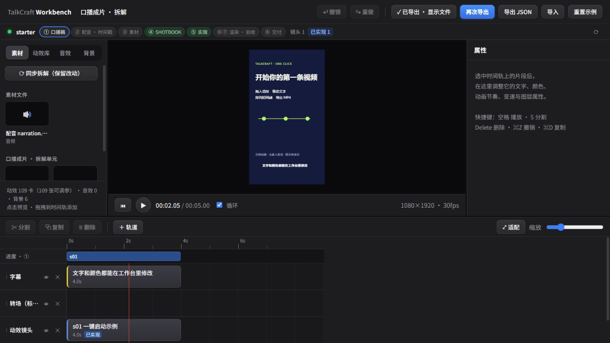

# TalkCraft OneClick · 一键启动动效剪辑工作台

[](https://github.com/freedomh/talkcraft-oneclick/actions/workflows/ci.yml)

将 [Video TalkCraft](https://github.com/Vincentwei1021/video-talkcraft) 工作台整理成可克隆的一键启动发行版：多轨时间线、文字动效、逐镜参数、同步字幕、MP4 导出。保留原作者 Vincent Wei 的署名和许可，增加 Windows 便携启动与跨平台导出适配。



**这是本地工作台，不是上传视频就会自动剪好的云服务。** 可以自己在时间线上编辑，也可以配合能读写本地项目的 AI 编码助手，按 [SKILL.md](SKILL.md) 制作口播工程。AI 账号、字幕识别模型与可选配音服务需要使用者自行配置；运行默认示例不需要 API Key。

## Windows：下载后双击

1. 点击 **Code → Download ZIP** 并完整解压，或运行：

   ```powershell
   git clone https://github.com/freedomh/talkcraft-oneclick.git
   cd talkcraft-oneclick
   .\start.cmd
   ```

2. 双击根目录 **start.cmd**。第一次需要联网，自动准备依赖和 Chrome Headless Shell。
3. 浏览器打开工作台，默认接入四秒竖屏示例。文字、颜色可以改，支持导出 MP4。

有 Node.js 22+ 时直接复用；没有合适版本时，从 nodejs.org 下载经过 SHA256 校验的便携 Node 到 `.local/`，不改系统安装。无需管理员权限、Git Bash、rsync 或预装系统 FFmpeg；标准导出使用 Remotion 随依赖提供的媒体工具。高级音频预处理/识别另见原项目指南。

已有 5199 端口被占用时自动选择后续空闲端口，请以启动窗口打印的地址为准。关闭网页不会停止服务；在启动窗口按 **Ctrl+C** 停止。

首次安装可能需要几分钟和数百 MB 下载；网络无法访问 npm、nodejs.org 或 Remotion 浏览器下载地址时会显示错误，修复网络后重试，**不会通过取消证书校验解决问题**。

## macOS / Linux

先安装 Node.js 22+（包含 npm），再执行：

```sh
git clone https://github.com/freedomh/talkcraft-oneclick.git
cd talkcraft-oneclick
sh start.sh
```

Linux 需要图形/字体运行库与中文字体，精简容器不一定自带。Windows x64 为本发行版的本机验证平台；其他系统由 CI 和使用者环境共同验证，不能把脚本存在理解为所有系统都已实机测试。

## 剪辑自己的素材

- 拖入动效卡、修改文案、在时间线上移动或裁切，点击“导出成片”。原有详细用法见 [工作台指南](workbench/GUIDE.md)。
- 准备独立项目，保留 `video/` 原片、`subtitles/` 参考字幕、`review/` 剪接与检查记录、`remotion/` 动画代码和 `out/` 成片。每条视频一个项目，不清空旧素材。
- **实际视频口播为准**，稿子只是参考。AI 助手需要重新对齐这条视频的音频与字幕，不复用上条片的文案和秒数。
- `remotion/src` 至少有 `Main.tsx`、`Root.tsx`；拆成多轨还需 `shots.ts`、`scenes/index.tsx`、`Subtitles.tsx`、`sfx.ts`、`timing.ts` 和 `camera.tsx`。可参考 `examples/starter/`。
- 接入已制作好的 Remotion 口播项目：停止工作台后运行以下命令，再启动。支持含空格/中文的路径。

  ```powershell
  npm run project -- "D:\Videos\我的口播项目"
  npm start
  ```

- 接入会建立本机目录链接并复制根级媒体文件，生成的本机路径不提交 Git。文件直接被替换后，重启一次可刷新复制；目录内文件通过链接实时可见。切换工程不会删除源工程。
- AI 工程保留实际原声，可选人物分层、关键词、真实网页和图解；每条片按题材选择构图，不固定套同一套颜色与卡片。示意画面要标注，不能把虚构案例当真实证据。
- 这个仓库**不包含任何使用者的真人原视频、账号资料、历史成片、API Key 或私有产品页面**。自用项目建议放在已忽略的 `projects/` 或仓库外部。

## 常用命令

| 命令 | 用途 |
|---|---|
| `npm start` | 检查环境并启动，自动打开浏览器 |
| `npm start -- --no-open --port 5200` | 指定起始端口、不自动开网页 |
| `npm run setup` | 仅安装/检查，不启动 |
| `npm run build` | 类型检查和前端构建，不复制项目媒体 |
| `npm test` | 回归测试与跨平台素材同步测试 |
| `npm run smoke` | 启动测试工作台并通过导出接口生成一秒 MP4 |
| `powershell -File scripts/start.ps1 -Portable -SetupOnly` | 验证便携 Node 首次安装分支 |

标准启动不执行旧版 `check-runtime.sh --upgrade`。Remotion 与所有 `@remotion/*` 固定为 **4.0.538**，依赖以 `runtime/package-lock.json` 为准；不要在单片目录重复 `npm install`。后续版本更新应统一修改、重新验证，再发布。

测试服务默认使用本机 5299，日常工作台自动从 5199 开始选择空闲端口。导出文件在 `workbench/exports/`；时间线编辑保存在当前浏览器的本地存储中，也可以导出工程 JSON。清理浏览器存储前请先备份工程 JSON。

运行请使用 `npm start`，不要只把 `dist/` 上传到静态网站：本地导出和项目读写需要工作台服务。源码带模板封面；原作者单独发布的预录缩略视频不随本仓库打包，点选模板后仍可实时预览和编辑。

## 目录

```text
start.cmd / start.sh       启动入口
scripts/oneclick.mjs       依赖、链接、端口与启动检查
runtime/                  共享依赖和精确锁文件
workbench/                时间线、预览、参数与导出服务
template/                 原项目动效模板
examples/starter/         不含真人资料的竖屏示例
.local/                   本机下载与状态，不上传
```

## 来源与许可

- 上游：[Vincentwei1021/video-talkcraft](https://github.com/Vincentwei1021/video-talkcraft)，来源与改动说明见 [UPSTREAM.md](UPSTREAM.md)，原版 README 保留在 [UPSTREAM_README.md](UPSTREAM_README.md)。
- 本仓库沿用 **PolyForm Noncommercial 1.0.0**，并完整保留 [LICENSE](LICENSE) 的 Required Notice。**非商业用途可依许可使用；商业使用工具须事先获得原作者授权**，不能将本发行版当作 MIT 或“无限制免费商用”工具。
- Remotion 本身另有许可要求，使用前查看 [Remotion 官方许可](https://www.remotion.dev/docs/license)。图片、图标、音效还应遵守 [THIRD_PARTY_NOTICES.md](THIRD_PARTY_NOTICES.md) 及对应 attribution。
- 本仓库不提供原作者商业授权，不包含他人的账号或订阅权益。
